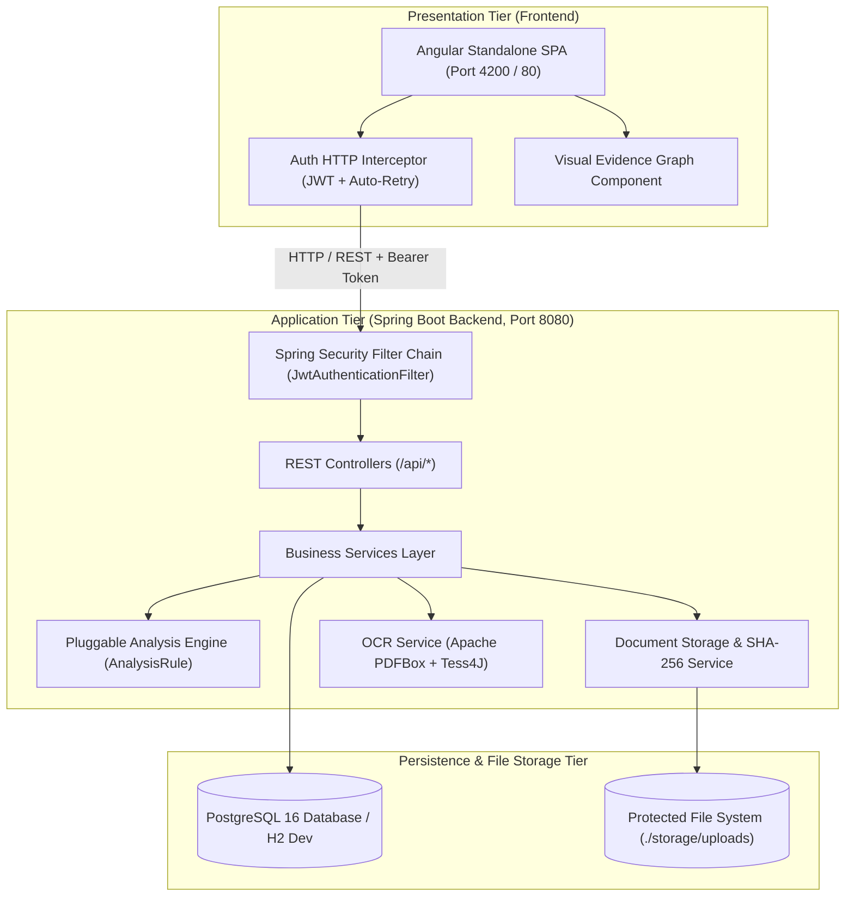
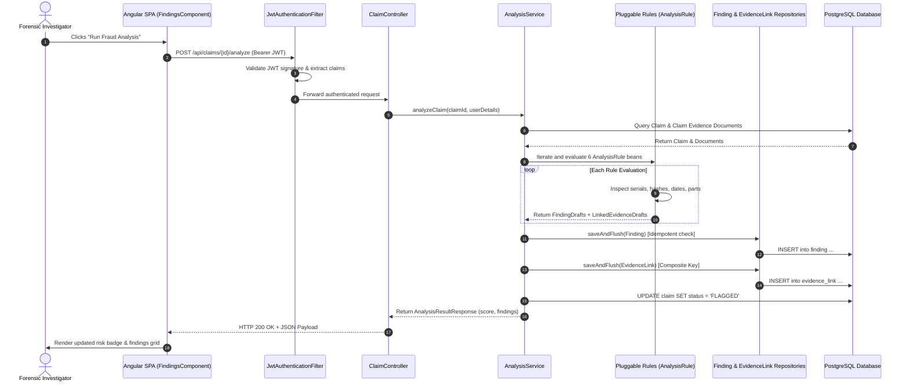
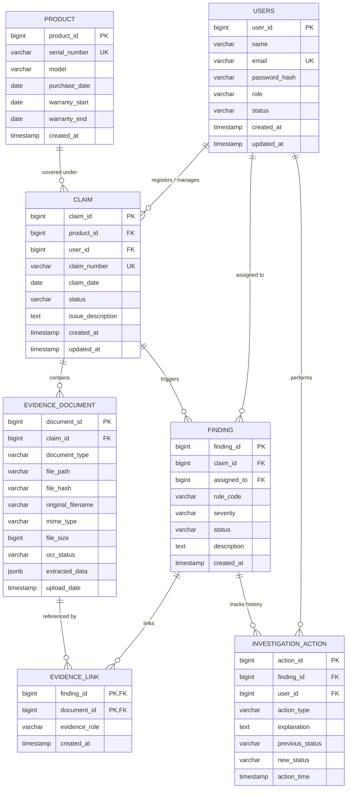
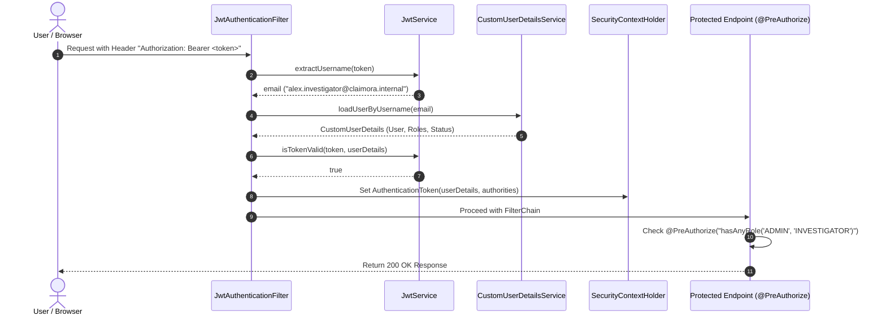

# Claimora: Enterprise Project Documentation
> **Evidence-Centric Warranty Claims Investigation & Fraud-Risk Analysis Platform**  
> *"Every alert has evidence. Every correction has a history. Every resolution has a reason."*

---

## 📑 Master Table of Contents
1. [Executive Summary & Project Overview](#1-executive-summary--project-overview)
2. [Problem Statement, Motivation & Industry Gaps](#2-problem-statement-motivation--industry-gaps)
3. [System Objectives & Measurable Success Metrics](#3-system-objectives--measurable-success-metrics)
4. [Target Audience & Stakeholder Personas](#4-target-audience--stakeholder-personas)
5. [Feature Catalog & Implementation Status Matrix](#5-feature-catalog--implementation-status-matrix)
6. [Business Impact, Innovation & Market Potential](#6-business-impact-innovation--market-potential)
7. [End-to-End Application Workflow & Lifecycle](#7-end-to-end-application-workflow--lifecycle)
8. [System Architecture & Interaction Diagrams](#8-system-architecture--interaction-diagrams)
9. [Technology Stack & Architectural Trade-off Analysis](#9-technology-stack--architectural-trade-off-analysis)
10. [Repository Directory & File Hierarchy](#10-repository-directory--file-hierarchy)
11. [Backend Architecture: MVC, OOP & Design Patterns](#11-backend-architecture-mvc-oop--design-patterns)
12. [Backend Code Walkthrough: Controllers, Services & Repositories](#12-backend-code-walkthrough-controllers-services--repositories)
13. [Database Architecture, Schema & Entity-Relationship (ER) Model](#13-database-architecture-schema--entity-relationship-er-model)
14. [Data Transfer Objects (DTOs), Validation & Serialization](#14-data-transfer-objects-dtos-validation--serialization)
15. [Spring Boot Concepts, Annotations & Application Lifecycle](#15-spring-boot-concepts-annotations--application-lifecycle)
16. [JPA, Hibernate ORM & Database Access Optimization](#16-jpa-hibernate-orm--database-access-optimization)
17. [Dependency Management & Build Configuration (`pom.xml` & `package.json`)](#17-dependency-management--build-configuration-pomxml--packagejson)
18. [Security Architecture: Stateless JWT, BCrypt & RBAC](#18-security-architecture-stateless-jwt-bcrypt--rbac)
19. [Secret Management & Environment Configuration](#19-secret-management--environment-configuration)
20. [Complete REST API Reference](#20-complete-rest-api-reference)
21. [Pluggable Fraud Detection Rules Engine & Scoring Math](#21-pluggable-fraud-detection-rules-engine--scoring-math)
22. [Document Storage, SHA-256 Fingerprinting & OCR Pipeline](#22-document-storage-sha-256-fingerprinting--ocr-pipeline)
23. [Append-Only Audit Trail & Immutability Enforcement](#23-append-only-audit-trail--immutability-enforcement)
24. [Frontend Architecture: Angular Standalone Components, Interceptors & Visual Graph](#24-frontend-architecture-angular-standalone-components-interceptors--visual-graph)
25. [Error Handling, Resilience & Logging Infrastructure](#25-error-handling-resilience--logging-infrastructure)
26. [API Testing, Swagger Documentation & Automated Verification](#26-api-testing-swagger-documentation--automated-verification)
27. [AI Integration Reality: Deterministic Rules vs Black-Box AI](#27-ai-integration-reality-deterministic-rules-vs-black-box-ai)
28. [Containerization, DevOps & Deployment Topology](#28-containerization-devops--deployment-topology)
29. [Team Work Division & Individual Entity Ownership Matrix](#29-team-work-division--individual-entity-ownership-matrix)

---

## 1. Executive Summary & Project Overview

**Claimora** is an enterprise-grade forensic investigation platform engineered to automate warranty fraud detection, accelerate claim triage, and enforce an immutable, append-only chain of custody. Built for electronics manufacturers, authorized service providers, and consumer warranty insurers, Claimora bridges the gap between raw document ingestion and human forensic adjudication.

Traditional warranty adjudication relies on manual, siloed document inspection where invoices, technician diagnostic logs, repair parts receipts, and product serial numbers are examined in isolation. This fragmented approach allows organized warranty fraud rings and opportunistic claimants to exploit systemic blind spots—such as reusing identical PDF receipts across unrelated customer claims, cycling damaged product photos, and submitting claims for expired warranty periods with doctored dates.

Claimora solves this by implementing an **evidence-centric triage platform**:
- Every uploaded document is cryptographically fingerprinted using **SHA-256 digests**.
- Textual artifacts and key-value fields are extracted automatically via **Apache PDFBox** and **Tess4J OCR**.
- A pluggable, multi-heuristic **fraud risk engine** evaluates claims against 6 forensic heuristics, assigning a bounded composite risk score (0–100) and generating directional evidence links.
- High-risk claims are automatically transitioned to **`FLAGGED`** for investigator triage, adhering strictly to the **No Auto-Rejection Principle** (ensuring final payout or rejection decisions remain strictly with authorized human investigators).
- Every investigator action, comment, data correction, and status transition is recorded in an **append-only audit table** that strictly forbids modification (`PUT`, `PATCH`) or deletion (`DELETE`), returning **HTTP 405 Method Not Allowed**.

---

## 2. Problem Statement, Motivation & Industry Gaps

### 2.1 The Problem Statement
In consumer electronics and durable goods industries, warranty servicing represents between **2% and 4% of total manufacturing revenue**. Industry estimates from warranty inspection agencies indicate that **up to 10% to 15% of all warranty payouts are fraudulent, inflated, or erroneous**.

Warranty fraud manifests in several complex typologies:
1. **Duplicate Invoice Recycling**: Claimants or rogue service centres submit the same legitimate purchase invoice across multiple claims under different customer names.
2. **Serial Number Recycling**: Repeated claims are submitted against a single valid serial number within short time windows, often claiming different defects.
3. **Ghost Invoices & Date Manipulation**: Invoices are post-dated or backdated to force an out-of-warranty device into the manufacturer's covered period.
4. **Digital Image Re-use**: Stock or prior damaged component photos are recycled to substantiate non-existent physical failures.
5. **Repair-Parts Discrepancies**: High-value repair parts (e.g., motherboard, OLED display) are claimed on repair invoices, whereas the technician diagnostic report specifies minor component adjustments.

### 2.2 Motivation
Warranty review teams face severe operational bottlenecks:
- **Dispersed Evidence**: Claim documents are stored as detached PDF attachments or email threads.
- **Cognitive Overload**: An investigator reviewing claim #102 has no feasible way to remember that the same invoice hash was submitted three weeks earlier in claim #045.
- **Unexplainable Black-Box Scores**: Generic machine learning solutions produce risk percentages without linking the score to tangible, legally defensible evidentiary proof.
- **Audit Tampering & Overwriting**: In legacy CRM or ticketing tools, editing a record overwrites earlier values, destroying the chain of custody required for legal prosecution or warranty recovery.

### 2.3 Industry Gaps & Claimora's Strategic Solutions
| Industry Gap in Legacy Systems | How Claimora Solves It |
| :--- | :--- |
| **Siloed Claim Verification**: Claims are inspected individually without cross-claim historical matching. | **Cross-Claim Digital Fingerprinting**: SHA-256 hash indexing across the entire evidence repository instantly flags cross-claim document recycling. |
| **Unexplained Anomaly Scores**: AI/ML models output risk numbers without citing the underlying contradictions. | **Explainable Forensic Findings**: Every finding specifies the exact rule, conflicting values, and direct links to the physical documents. |
| **Destructive Data Edits**: Correcting an OCR error overwrites original extraction data. | **Dual-Record Evidence Preservation**: Original OCR extractions are immutable; human corrections are logged as distinct audit actions. |
| **Premature Auto-Rejection**: Automated algorithms reject legitimate claims due to scanning artifacts, harming customer goodwill. | **No Auto-Rejection Principle**: Automation only flags claims for human triage; final resolution decisions require human review. |
| **Vulnerable Audit Logs**: Action histories can be pruned or modified in the database. | **Append-Only Immutability**: Controller rejects any edit/delete with HTTP 405; database foreign keys enforce strict reference integrity. |

---

## 3. System Objectives & Measurable Success Metrics

### 3.1 Primary System Objectives
1. **Automated Cross-Document Consistency**: Detect cross-claim and cross-document inconsistencies across invoices, serial numbers, warranty dates, and repair parts.
2. **Deterministic Evidence Traceability**: Provide explicit, directional links connecting each raised finding to the exact supporting and conflicting evidence documents.
3. **Tamper-Proof Forensic Accountability**: Maintain an append-only historical timeline of every action, status change, and mandatory explanation taken during an investigation.
4. **Intuitive Forensic Visualization**: Offer an interactive Visual Evidence Graph where investigators can visually inspect relationship nodes between findings and documents.

### 3.2 Measurable Success Metrics
- **Analysis Execution Time**: < 500 ms per claim across all 6 forensic rules.
- **Idempotency Guarantee**: 100% idempotent finding generation (repeated analysis executions never generate duplicate open findings).
- **Audit Integrity**: 0% modification rate for recorded investigation actions (enforced by HTTP 405 and service layer validation).
- **Test Coverage**: Comprehensive unit and integration test coverage across all rules, services, controllers, and storage utilities (61 passing automated tests).

---

## 4. Target Audience & Stakeholder Personas

```
                     ┌─────────────────────────────────────────┐
                     │          Claimora User Personas         │
                     └────────────────────┬────────────────────┘
                                          │
         ┌────────────────────────────────┼────────────────────────────────┐
         ▼                                ▼                                ▼
┌──────────────────┐             ┌──────────────────┐             ┌──────────────────┐
│  Claims Staff    │             │  Investigator    │             │  System Admin    │
│  (Intake Tier)   │             │  (Forensic Tier) │             │  (Governance)    │
└──────────────────┘             └──────────────────┘             └──────────────────┘
```

### Persona 1: Claims Intake Staff (`STAFF`)
- **Profile**: Customer service representatives, warranty intake clerks, authorized service centre staff.
- **Responsibilities**: Register new electronic products, submit customer warranty claims, upload invoices, diagnostic reports, and damage photographs.
- **System Scope**: Restricted to viewing and managing claims within their intake scope; cannot assign investigators or resolve fraud findings.

### Persona 2: Warranty Fraud Investigator (`INVESTIGATOR`)
- **Profile**: Forensic auditors, senior warranty adjudicators, claims investigation specialists.
- **Responsibilities**: Triage flagged claims, inspect conflicting evidence via the Visual Evidence Graph, request additional documentation, correct OCR extraction misreads, resolve or dismiss findings with mandatory written rationales.
- **System Scope**: Full access to all claims, documents, findings, and investigation actions; can update finding statuses and transition claim lifecycles.

### Persona 3: System Administrator / Risk Manager (`ADMIN`)
- **Profile**: Risk managers, compliance directors, platform IT administrators.
- **Responsibilities**: User provisioning, investigator role assignments, account lifecycle management (activate/deactivate), high-level executive dashboard inspection, and platform KPI auditing.
- **System Scope**: Unrestricted system-wide access, including user administrative endpoints (`/api/users/**`) and investigator assignments (`/api/findings/{id}/assign`).

---

## 5. Feature Catalog & Implementation Status Matrix

The following table reflects the actual codebase implementation:

| Module / Capability | Feature Description | Implementation Status | Codebase File Reference |
| :--- | :--- | :---: | :--- |
| **Authentication** | Stateless JWT authentication (HMAC-SHA256, 24-hr expiry) | **Implemented** | `com.claimora.security.JwtService` |
| **User Management** | Admin CRUD, status activation/deactivation, password management | **Implemented** | `com.claimora.service.UserService` |
| **RBAC Security** | Method-level security (`@PreAuthorize`) for `ADMIN`, `INVESTIGATOR`, `STAFF` | **Implemented** | `com.claimora.security.SecurityConfig` |
| **Product Catalog** | Product registration, serial number unique constraint, warranty dates check | **Implemented** | `com.claimora.service.ProductService` |
| **Claims Management** | Claim creation, auto-generated claim numbers (`CLM-YYYY-XXXXXX`), status tracking | **Implemented** | `com.claimora.service.ClaimService` |
| **Evidence Storage** | Local protected disk storage, directory traversal prevention, metadata tracking | **Implemented** | `com.claimora.storage.DocumentStorageService` |
| **Digital Hashing** | SHA-256 cryptographic file digest calculation upon upload | **Implemented** | `com.claimora.storage.DocumentStorageService` |
| **Document OCR** | Apache PDFBox text extraction + Tess4J OCR fallback + regex field parsing | **Implemented** | `com.claimora.ocr.OcrServiceImpl` |
| **OCR Field Correction** | Reviewer manual override of extracted data with audit logging | **Implemented** | `com.claimora.service.EvidenceDocumentService` |
| **Rules Engine** | Modular `AnalysisRule` interface with 6 pluggable forensic heuristics | **Implemented** | `com.claimora.analysis.rules.*` |
| **Duplicate Invoice Rule** | Flags duplicate invoice numbers and identical SHA-256 file hashes across claims | **Implemented** | `com.claimora.analysis.rules.DuplicateInvoiceRule` |
| **Serial Reuse Rule** | Detects repeat warranty claims on the same serial number within 90 days | **Implemented** | `com.claimora.analysis.rules.SerialReuseRule` |
| **Date Conflict Rule** | Detects claims outside warranty period or invoice post-dating claim | **Implemented** | `com.claimora.analysis.rules.DateConflictRule` |
| **Invoice Mismatch Rule** | Detects discrepancies between invoice OCR extracted data and product catalog | **Implemented** | `com.claimora.analysis.rules.InvoiceMismatchRule` |
| **Duplicate Photo Rule** | Uncovers identical photo SHA-256 hashes across different claims | **Implemented** | `com.claimora.analysis.rules.DuplicatePhotoRule` |
| **Repair Parts Mismatch** | Identifies conflicting parts descriptions between repair reports and invoices | **Implemented** | `com.claimora.analysis.rules.RepairPartsMismatchRule` |
| **Composite Scoring** | Bounded risk score (0–100) and risk level assignment (`LOW`, `MEDIUM`, `HIGH`, `CRITICAL`) | **Implemented** | `com.claimora.service.AnalysisService` |
| **Claim Auto-Flagging** | Automatically transitions claim status to `FLAGGED` when active findings exist | **Implemented** | `com.claimora.service.AnalysisService` |
| **Evidence Linking** | Directional evidence links (`CONFLICTING_VALUE`, `DUPLICATE_OF`, `SUPPORTING_EVIDENCE`) | **Implemented** | `com.claimora.entity.EvidenceLink` |
| **Investigation Trail** | Append-only audit logger enforcing mandatory explanations on status change | **Implemented** | `com.claimora.service.InvestigationActionService` |
| **Audit Immutability** | HTTP 405 Method Not Allowed returned on `PUT`, `PATCH`, `DELETE` of actions | **Implemented** | `com.claimora.controller.InvestigationActionController` |
| **Visual Evidence Graph** | Interactive Angular relational node visualizer linking findings and documents | **Implemented** | `frontend/src/app/features/findings` |
| **Dashboard KPIs** | Aggregate counters, claims by status, findings by severity, rule triggers | **Implemented** | `com.claimora.service.DashboardService` |
| **Swagger / OpenAPI** | Interactive OpenAPI 3.0 UI and JSON docs (`/swagger-ui.html`, `/v3/api-docs`) | **Implemented** | `com.claimora.config.OpenApiConfig` |
| **Dockerized Deployment** | Multi-container Docker Compose setup (PostgreSQL, Backend WAR, Angular Nginx) | **Implemented** | `docker-compose.yml` |
| **Service Centre Table** | Dedicated service centre entity and location tracking | **Planned** (Reserved for v2) | Documented in `database/schema.sql` |
| **Perceptual Image Hashing** | pHash / perceptual similarity for cropped/re-saved photo detection | **Planned** (Reserved for v2) | Current uses exact SHA-256 |
| **AI / ML Predictive Model** | Random Forest / XGBoost fraud scoring or LLM case summarization | **Planned** (Future Roadmap) | Current uses deterministic rule engine |

---

## 6. Business Impact, Innovation & Market Potential

### 6.1 Return on Investment (ROI)
For an electronics brand processing 100,000 warranty claims annually with an average repair/replacement cost of \$250:
- **Total Annual Payout**: \$25,000,000.
- **Estimated Fraud/Erroneous Claims (10%)**: \$2,500,000.
- **Claimora Impact**: By catching 60% of invoice recycling, serial cycling, and expired date manipulation during initial intake, the platform recovers approximately **\$1,500,000 annually**, achieving a complete ROI within weeks of enterprise rollout.

### 6.2 Key Innovations
1. **Explainable Triage vs. Black-Box Scoring**: Unlike opaque AI classifiers that generate an indefensible fraud probability, Claimora outputs tangible evidence links: *"Invoice #INV-2025-00101 submitted in Claim CLM-102 was already submitted in Claim CLM-101 on 2025-01-10 with identical SHA-256 hash `e3b0c442...`"*.
2. **Dual-Layer Forensic Storage**: Raw evidence bytes remain isolated on protected disk storage while cryptographic SHA-256 digests and JSONB extracted fields are indexed in PostgreSQL.
3. **Immutable State Governance**: Legal defensibility is guaranteed through append-only audit enforcement—investigation notes and resolution justifications cannot be modified after the fact.

---

## 7. End-to-End Application Workflow & Lifecycle

The lifecycle of a warranty claim through Claimora flows across three distinct operational phases: **Intake**, **Automated Analysis**, and **Human Adjudication**.

```mermaid
flowchart TD
    subgraph Intake["Phase 1: Claim Intake & Evidence Upload"]
        A[Customer / Staff Registers Product] --> B[Staff Submits Warranty Claim]
        B --> C[Staff Uploads Evidence Document]
        C --> D[Compute SHA-256 Hash & Store File on Disk]
        D --> E[Execute OCR & Extract JSON Fields]
    end

    subgraph Analysis["Phase 2: Automated Forensic Analysis"]
        E --> F[Trigger Analysis Engine: POST /claims/{id}/analyze]
        F --> G[Evaluate 6 Modular Forensic Rules]
        G --> H{Any Discrepancies Discovered?}
        H -- No --> I[Claim Remains in Review / Low Risk Score]
        H -- Yes --> J[Generate Idempotent Findings]
        J --> K[Link Conflicting & Supporting Evidence]
        K --> L[Calculate Composite Score 0-100]
        L --> M[Auto-Transition Claim Status to FLAGGED]
    end

    subgraph Investigation["Phase 3: Forensic Adjudication"]
        M --> N[Investigator Examines Flagged Claim in Dashboard]
        N --> O[Open Visual Evidence Graph Modal]
        O --> P[Inspect Conflicting Documents & OCR Data]
        P --> Q{Decision Path}
        Q -- Request More Info --> R[Record Action: REQUEST_EVIDENCE]
        Q -- False Alarm --> S[Record Action: DISMISS + Mandatory Rationale]
        Q -- Confirmed Abuse --> T[Record Action: RESOLVE + Final Justification]
        R --> U[Action Appended to Audit Trail - Cannot be Edited/Deleted]
        S --> U
        T --> U
    end
```

---

## 8. System Architecture & Interaction Diagrams

Claimora follows a modern, decoupled layered architecture. The client browser communicates with the Spring Boot backend via JSON REST APIs over HTTP, while the backend orchestrates data access, file storage, and security.

### 8.1 High-Level Component Architecture


### 8.2 End-to-End Request Flow (Sequence Diagram)
The following sequence diagram traces the complete execution flow when an investigator analyzes a claim:



---

## 9. Technology Stack & Architectural Trade-off Analysis

### 9.1 Technology Stack Summary
| Architectural Layer | Technology Selected | Version | Purpose / Role |
| :--- | :--- | :---: | :--- |
| **Frontend Framework** | Angular (Standalone Components) | `22.2.0` | Enterprise SPA, reactive data flow, strict typing |
| **Language (Frontend)** | TypeScript | `6.0.2` | Compile-time safety, interfaces, strict null checks |
| **Styling** | Modern Vanilla CSS | CSS3 | Zero UI bloat, dark glassmorphic design, CSS variables |
| **Backend Framework** | Spring Boot | `4.1.2` | Enterprise REST APIs, DI container, ecosystem |
| **Language (Backend)** | Java | `17` (LTS) | Strong OOP, type safety, memory safety, concurrency |
| **Security** | Spring Security + JJWT | `0.12.6` | Stateless token validation, method-level security |
| **Persistence (ORM)** | Spring Data JPA / Hibernate ORM | `7.4.x` | Object-relational mapping, transactional semantics |
| **Database (Prod)** | PostgreSQL | `16+` | ACID transactions, JSONB, check constraints, indexes |
| **Database (Dev/Test)** | H2 Database (In-Memory) | `2.4.x` | Zero-configuration local startup and fast testing |
| **Connection Pool** | HikariCP | Default | High-performance, lightweight JDBC connection pooling |
| **PDF Extraction** | Apache PDFBox | `3.0.4` | Structured text extraction from PDF documents |
| **Image OCR** | Tess4J (Tesseract OCR) | `5.14.0` | Optical character recognition on scanned images |
| **API Documentation** | SpringDoc OpenAPI (Swagger UI) | `2.8.9` | Auto-generated interactive API documentation |
| **Build Tools** | Maven Wrapper (`./mvnw`), npm | Latest | Deterministic, reproducible builds across developer machines |
| **Containerization** | Docker & Docker Compose | Latest | Standardized container deployment with health checks |

### 9.2 Comprehensive Trade-Off Analysis

#### 1. Backend: Spring Boot (Java) vs. Express.js (Node.js) vs. Django (Python)
- **Why Spring Boot Won**:
  - *Type Safety & Refactoring*: In a complex forensic domain involving financial liabilities, compile-time type safety prevents runtime attribute typos.
  - *Enterprise Security*: Spring Security provides robust, battle-tested filters, method-level security annotations (`@PreAuthorize`), and declarative transaction management (`@Transactional`).
  - *Dependency Injection*: Spring's IoC container allows seamless pluggable rule discovery by simply autowiring `List<AnalysisRule>`.
- **Trade-offs**: Slightly slower cold-start times and higher memory footprint than Node.js microservices; mitigated in production via container memory allocation and connection pooling.

#### 2. Frontend: Angular (v22 Standalone) vs. React vs. Vue.js
- **Why Angular Won**:
  - *Built-in Architectural Standards*: Angular provides an opinionated structure (routing, HTTP client, interceptors, guards) out of the box, ensuring all 6 team members adhere to identical coding conventions.
  - *Standalone Components*: Modern Angular eliminates bloated `NgModule` boilerplate, providing modular, tree-shakable components.
  - *HTTP Interceptors*: Angular's functional interceptors seamlessly handle Bearer token injection, transient failure auto-retries, and centralized 401 redirect logic.
- **Trade-offs**: Steeper initial learning curve than React; compensated by long-term maintainability and cohesive TypeScript models.

#### 3. Database: PostgreSQL vs. MongoDB vs. Neo4j
- **Why PostgreSQL Won**:
  - *Relational Integrity & Foreign Keys*: Forensic investigations require strict referential integrity (`ON DELETE RESTRICT` for claims, cascading for evidence links). Document databases (MongoDB) risk orphan records.
  - *Hybrid Capabilities (JSONB)*: PostgreSQL provides native JSONB support for OCR extracted data, allowing structured relational queries alongside dynamic document schemas.
  - *PostgreSQL vs Neo4j*: While the Evidence Graph is relational, a dedicated graph database (Neo4j) introduces operational overhead in small-to-medium enterprise setups. Modeling evidence connections using an `evidence_link` join table provides graph-like traversal using standard SQL joins without additional infrastructure.

---

## 10. Repository Directory & File Hierarchy

```
Claimora/
├── .env                                  # Environment variables (local config)
├── .env.example                          # Sample template for environment configuration
├── .gitignore                            # Git exclusion rules
├── docker-compose.yml                    # Multi-container orchestration (PostgreSQL, Backend, Frontend)
├── README.md                             # Project overview and quickstart instructions
├── CLAIMORA_PROJECT_DOCUMENTATION.md     # Comprehensive technical documentation
├── CLAIMORA_EVALUATION_QA.md             # Evaluator defense guide and Q&A handbook
│
├── backend/                              # Spring Boot REST API Application
│   ├── pom.xml                           # Maven dependencies and build configuration
│   ├── mvnw / mvnw.cmd                   # Maven wrapper executables
│   └── src/
│       ├── main/
│       │   ├── java/com/claimora/
│       │   │   ├── BackendApplication.java       # Spring Boot main entrypoint & WAR bootstrapper
│       │   │   ├── analysis/                     # Pluggable Fraud Detection Engine
│       │   │   │   ├── AnalysisContext.java      # Evaluation context containing claim & documents
│       │   │   │   ├── AnalysisRule.java         # Interface for all forensic fraud rules
│       │   │   │   ├── FindingDraft.java         # Intermediate DTO for findings created by rules
│       │   │   │   ├── FraudRuleEvaluator.java   # Baseline rule evaluator
│       │   │   │   ├── LinkedEvidenceDraft.java  # Intermediate DTO for evidence links
│       │   │   │   ├── RiskScoreResult.java      # Risk calculation result wrapper
│       │   │   │   └── rules/                    # Concrete Rule Implementations
│       │   │   │       ├── DateConflictRule.java
│       │   │   │       ├── DuplicateInvoiceRule.java
│       │   │   │       ├── DuplicatePhotoRule.java
│       │   │   │       ├── InvoiceMismatchRule.java
│       │   │   │       ├── RepairPartsMismatchRule.java
│       │   │   │       └── SerialReuseRule.java
│       │   │   ├── audit/                        # Audit logging components
│       │   │   │   └── AuditTrailLogger.java     # Forensic action logging helper
│       │   │   ├── config/                       # Application Configurations
│       │   │   │   ├── CorsConfig.java           # Cross-Origin Resource Sharing policy
│       │   │   │   ├── DataInitializer.java      # Baseline database seeder (Admin, Investigator, Demo cases)
│       │   │   │   ├── JacksonConfig.java        # JSON serialization configuration
│       │   │   │   └── OpenApiConfig.java        # Swagger / OpenAPI 3.0 specification
│       │   │   ├── controller/                   # REST API Controllers (Presentation Layer)
│       │   │   │   ├── AuthController.java
│       │   │   │   ├── ClaimController.java
│       │   │   │   ├── DashboardController.java
│       │   │   │   ├── EvidenceDocumentController.java
│       │   │   │   ├── FindingController.java
│       │   │   │   ├── HealthController.java
│       │   │   │   ├── InvestigationActionController.java
│       │   │   │   ├── ProductController.java
│       │   │   │   ├── ReportController.java
│       │   │   │   └── UserController.java
│       │   │   ├── dto/                          # Data Transfer Objects (Requests & Responses)
│       │   │   │   ├── AdminCreateUserRequest.java
│       │   │   │   ├── AnalysisResultResponse.java
│       │   │   │   ├── AssignFindingRequest.java
│       │   │   │   ├── ChangePasswordRequest.java
│       │   │   │   ├── ClaimRequest.java / ClaimResponse.java
│       │   │   │   ├── DashboardStatsResponse.java
│       │   │   │   ├── ErrorResponse.java
│       │   │   │   ├── EvidenceDocumentResponse.java / EvidenceLinkResponse.java
│       │   │   │   ├── FindingResponse.java
│       │   │   │   ├── InvestigationActionRequest.java / InvestigationActionResponse.java
│       │   │   │   ├── LoginRequest.java / LoginResponse.java
│       │   │   │   ├── ProductRequest.java / ProductResponse.java / ProductDto.java
│       │   │   │   ├── RegisterRequest.java
│       │   │   │   ├── ReportSummaryResponse.java / RuleTriggerStat.java
│       │   │   │   ├── UpdateExtractedDataRequest.java / UpdateRoleRequest.java / UpdateStatusRequest.java
│       │   │   │   └── UserResponse.java / UserDto.java
│       │   │   ├── entity/                       # JPA Database Entities
│       │   │   │   ├── ActionType.java           # Enum (COMMENT, RESOLVE, DISMISS, etc.)
│       │   │   │   ├── Claim.java                # Claim domain entity
│       │   │   │   ├── ClaimStatus.java          # Enum (SUBMITTED, UNDER_REVIEW, FLAGGED, RESOLVED)
│       │   │   │   ├── DocumentType.java         # Enum (INVOICE, REPAIR_REPORT, PARTS_INVOICE, PHOTO)
│       │   │   │   ├── EvidenceDocument.java     # Document metadata, SHA-256 hash & OCR entity
│       │   │   │   ├── EvidenceLink.java         # Relationship entity connecting Finding & Document
│       │   │   │   ├── EvidenceLinkId.java       # Composite primary key for EvidenceLink
│       │   │   │   ├── EvidenceRole.java         # Enum (CONFLICTING_VALUE, DUPLICATE_OF, SUPPORTING)
│       │   │   │   ├── Finding.java              # Fraud finding entity
│       │   │   │   ├── FindingSeverity.java      # Enum (LOW, MEDIUM, HIGH)
│       │   │   │   ├── FindingStatus.java        # Enum (OPEN, UNDER_INVESTIGATION, RESOLVED, DISMISSED)
│       │   │   │   ├── InvestigationAction.java  # Append-only audit record entity
│       │   │   │   ├── Product.java              # Product domain entity
│       │   │   │   ├── Role.java                 # Enum (ADMIN, INVESTIGATOR, STAFF)
│       │   │   │   ├── User.java                 # User account entity
│       │   │   │   └── UserStatus.java           # Enum (ACTIVE, INACTIVE)
│       │   │   ├── exception/                    # Global Exception Handling
│       │   │   │   ├── GlobalExceptionHandler.java # Centralized @RestControllerAdvice
│       │   │   │   ├── ResourceNotFoundException.java
│       │   │   │   └── ValidationException.java
│       │   │   ├── ocr/                          # Optical Character Recognition Engine
│       │   │   │   ├── OcrResult.java            # DTO containing extracted text and JSON
│       │   │   │   ├── OcrService.java           # OCR contract
│       │   │   │   └── OcrServiceImpl.java       # Implementation via PDFBox and Tess4J
│       │   │   ├── repository/                   # Spring Data JPA Repositories
│       │   │   │   ├── ClaimRepository.java
│       │   │   │   ├── EvidenceDocumentRepository.java
│       │   │   │   ├── EvidenceLinkRepository.java
│       │   │   │   ├── FindingRepository.java
│       │   │   │   ├── InvestigationActionRepository.java
│       │   │   │   ├── ProductRepository.java
│       │   │   │   └── UserRepository.java
│       │   │   ├── security/                     # Spring Security & JWT Implementation
│       │   │   │   ├── CustomUserDetails.java    # Bridge to Spring Security UserDetails
│       │   │   │   ├── CustomUserDetailsService.java # Database user loading
│       │   │   │   ├── JwtAuthenticationFilter.java  # Bearer token validation filter
│       │   │   │   ├── JwtService.java               # Token generation, signing, and verification
│       │   │   │   ├── RestAccessDeniedHandler.java  # JSON 403 Forbidden handler
│       │   │   │   ├── RestAuthenticationEntryPoint.java # JSON 401 Unauthorized handler
│       │   │   │   └── SecurityConfig.java           # Main Spring Security configuration
│       │   │   ├── service/                      # Business Logic Layer
│       │   │   │   ├── AnalysisService.java      # Rules engine orchestration & scoring
│       │   │   │   ├── AuthService.java          # Authentication and token issuance
│       │   │   │   ├── ClaimService.java         # Claim lifecycle management
│       │   │   │   ├── DashboardService.java      # Dashboard metrics & analytics
│       │   │   │   ├── EvidenceDocumentService.java # Upload, retrieval & OCR correction
│       │   │   │   ├── FindingService.java       # Finding retrieval & assignment
│       │   │   │   ├── InvestigationActionService.java # State transitions & audit logging
│       │   │   │   ├── ProductService.java       # Product management
│       │   │   │   └── UserService.java          # User management
│       │   │   └── storage/                      # File Storage & Hashing
│       │   │       ├── DocumentStorageService.java # Protected disk storage & SHA-256 calculation
│       │   │       └── StoredFileInfo.java       # File metadata wrapper
│       │   └── resources/
│       │       ├── application.properties        # Production PostgreSQL configuration
│       │       └── application-dev.properties    # Development In-Memory H2 configuration
│       └── test/                                 # Automated Test Suite (61 tests)
│           └── java/com/claimora/
│               ├── AnalysisRulesTest.java
│               ├── AnalysisServiceTest.java
│               ├── AuthControllerIntegrationTest.java
│               ├── AuthServiceTest.java
│               ├── ClaimServiceTest.java
│               ├── DashboardServiceTest.java
│               ├── DocumentStorageServiceTest.java
│               ├── EvidenceDocumentServiceTest.java
│               ├── InvestigationActionControllerTest.java
│               ├── InvestigationActionServiceTest.java
│               ├── OcrServiceTest.java
│               ├── ProductControllerIntegrationTest.java
│               ├── ProductServiceTest.java
│               ├── UserControllerIntegrationTest.java
│               └── UserServiceTest.java
│
├── frontend/                             # Angular Standalone Single Page Application
│   ├── package.json                      # Angular 22 & npm dependencies
│   ├── angular.json                      # Angular workspace configuration
│   ├── proxy.conf.json                   # Dev proxy routing /api/* to localhost:8080
│   └── src/
│       ├── main.ts                       # Angular application bootstrapper
│       ├── styles.css                    # Global dark-mode glassmorphic styling
│       └── app/
│           ├── app.component.ts          # Root component & navigation shell
│           ├── app.routes.ts             # Route definitions with guards
│           ├── app.config.ts             # Application providers (Router, HttpClient, Interceptors)
│           ├── core/                     # Core Singleton Services & Guards
│           │   ├── auth/auth.service.ts  # Token persistence, user state, login/logout
│           │   ├── guards/
│           │   │   ├── auth.guard.ts     # Route protection requiring authentication
│           │   │   ├── role.guard.ts     # Route protection requiring specific roles (e.g., ADMIN)
│           │   │   └── public.guard.ts   # Redirects logged-in users away from login page
│           │   └── interceptors/
│           │       └── auth.interceptor.ts # Functional Bearer token injector & auto-retry
│           ├── features/                 # Modular Feature Views
│           │   ├── auth/auth.component.ts        # Login & user registration
│           │   ├── claims/claims.component.ts    # Claims intake, filtering & analysis trigger
│           │   ├── dashboard/dashboard.component.ts # Executive analytics & KPI cards
│           │   ├── evidence/evidence.component.ts   # Evidence Explorer & OCR correction modal
│           │   ├── findings/findings.component.ts   # Findings grid, Visual Evidence Graph modal
│           │   ├── investigations/investigations.component.ts # Append-only timeline view
│           │   ├── landing/landing.component.ts  # Public presentation landing page
│           │   ├── products/products.component.ts # Product catalog management
│           │   ├── profile/profile.component.ts  # User profile & password change
│           │   ├── reports/reports.component.ts  # Executive reporting & rule statistics
│           │   └── users/users.component.ts      # Admin user management & role provisioning
│           ├── models/                   # TypeScript Data Models
│           │   ├── api-response.model.ts
│           │   ├── claim.model.ts
│           │   ├── dashboard.model.ts
│           │   ├── evidence.model.ts
│           │   ├── finding.model.ts
│           │   ├── investigation.model.ts
│           │   ├── product.model.ts
│           │   └── user.model.ts
│           └── services/                 # Feature API Services
│               ├── api.service.ts
│               ├── claim.service.ts
│               ├── dashboard.service.ts
│               ├── evidence.service.ts
│               ├── finding.service.ts
│               ├── investigation.service.ts
│               ├── product.service.ts
│               └── user.service.ts
│
├── database/                             # Database DDL & Seed Scripts
│   ├── schema.sql                        # PostgreSQL production schema & constraints
│   ├── seed.sql                          # Demonstration data with planted fraud scenarios
│   └── README.md
│
├── storage/                              # Protected Local Storage (Git-ignored)
│   └── uploads/                          # Document files (invoices, reports, photos)
│
└── docs-and-tests/                       # QA Assets & Postman Collections
    ├── Claimora_API_Collection.postman_collection.json # Comprehensive Postman collection
    ├── api-documentation.md              # API endpoint specs
    └── api-test-cases.md                 # Complete manual and automated QA test matrix
```

---

## 11. Backend Architecture: MVC, OOP & Design Patterns

The Claimora backend adheres strictly to the **Model-View-Controller (MVC)** architectural pattern adapted for headless RESTful APIs, combined with established Object-Oriented Programming (OOP) and enterprise design patterns.

### 11.1 The MVC Flow in Claimora
1. **Model**: Encompasses JPA entity classes (`com.claimora.entity.*`) representing relational tables, and Spring Data Repositories executing persistence queries.
2. **View**: In our headless REST architecture, the "View" is the JSON payload constructed via Data Transfer Objects (`com.claimora.dto.*`) serialized by Jackson.
3. **Controller**: REST controllers (`com.claimora.controller.*`) annotate endpoints with `@RestController`, validate inbound requests via `@Valid`, inspect security principals, and delegate execution to the service tier.

```
[Browser / Postman]
        │
   (HTTP JSON)
        ▼
[REST Controller] ─── Validates DTOs (@Valid) & Enforces Security (@PreAuthorize)
        │
   (DTO / Domain)
        ▼
[Service Layer]   ─── Orchestrates Business Logic, Transactions (@Transactional), & Rules
        │
   (Entity Model)
        ▼
[JPA Repository]  ─── Executes Parameterized Queries & Spring Data Interfaces
        │
      (SQL)
        ▼
[PostgreSQL Database]
```

### 11.2 Core Object-Oriented Principles Applied
- **Encapsulation**: Entities and DTOs encapsulate private fields with explicit getter and setter methods. State changes in entities (e.g., transitioning `ClaimStatus`) occur through validated domain methods.
- **Inheritance & Interfaces**: The pluggable analysis engine defines a common contract, `AnalysisRule`. Every concrete fraud rule implements this interface, ensuring standard method signatures (`evaluate(AnalysisContext)`).
- **Polymorphism**: In `AnalysisService`, Spring autowires all implementations of `AnalysisRule` into a `List<AnalysisRule>`. The service iterates over the list polymorphically without knowing the concrete class of each rule:
  ```java
  for (AnalysisRule rule : rules) {
      List<FindingDraft> drafts = rule.evaluate(context);
      // Process findings polymorphically
  }
  ```

### 11.3 Enterprise Design Patterns in Claimora
1. **Strategy Pattern**: Applied in the rules engine. Each fraud detection rule (`DuplicateInvoiceRule`, `SerialReuseRule`, etc.) encapsulates an independent strategy for detecting anomalies. New rules can be added without modifying the core orchestrator (`AnalysisService`), satisfying the **Open/Closed Principle**.
2. **Repository Pattern**: Spring Data JPA repositories (`ClaimRepository`, `FindingRepository`) decouple the business logic from underlying database access mechanics.
3. **Data Transfer Object (DTO) Pattern**: Separate request and response classes isolate internal database schemas from external API contracts, preventing over-posting vulnerabilities and accidental serialization of sensitive fields (e.g., `password_hash`).
4. **Builder / Static Factory Pattern**: Used in creating DTO responses (e.g., `AnalysisResultResponse.builder()`) and standardized error envelopes (`ErrorResponse`).
5. **Chain of Responsibility Pattern**: Implemented in Spring Security's `SecurityFilterChain`, where incoming HTTP requests traverse a succession of security filters (`JwtAuthenticationFilter`, `UsernamePasswordAuthenticationFilter`, `ExceptionTranslationFilter`).

---

## 12. Backend Code Walkthrough: Controllers, Services & Repositories

### 12.1 Controllers (`com.claimora.controller`)
Controllers handle HTTP routing, request parsing, and response formatting:
- **`AuthController`**: Exposes `/api/auth/login`, `/api/auth/register`, and `/api/auth/me`. Manages authentication token issuance.
- **`ClaimController`**: Exposes `/api/claims`. Allows staff to create and query claims, upload evidence documents via multipart form data (`/{id}/documents`), and run analysis (`/{id}/analyze`).
- **`FindingController`**: Exposes `/api/findings`. Enables investigators to query findings by severity/status, retrieve associated action timelines (`/{id}/actions`), and allows admins to assign findings to investigators (`/{id}/assign`).
- **`InvestigationActionController`**: Exposes `/api/investigations`. Provides access to recent actions across the platform. Critically, it implements explicit reject handlers for `PUT`, `DELETE`, and `PATCH` methods:
  ```java
  @PutMapping("/{id}")
  @PreAuthorize("isAuthenticated()")
  public ResponseEntity<Void> updateActionForbidden(@PathVariable("id") Long id) {
      throw new ResponseStatusException(
              HttpStatus.METHOD_NOT_ALLOWED,
              "Investigation actions are strictly append-only audit records and cannot be modified."
      );
  }
  ```
- **`EvidenceDocumentController`**: Exposes `/api/documents`. Provides document metadata retrieval, file streaming (`/{id}/file`), and manual OCR data correction (`/{id}/extracted-data`).
- **`ProductController`**: Exposes `/api/products` for product catalog registration and serial number searching.
- **`DashboardController` & `ReportController`**: Expose `/api/dashboard/stats` and `/api/reports/summary`, delivering executive metrics and rule trigger statistics.
- **`UserController`**: Exposes administrative endpoints (`/api/users/**`) for account lifecycle management, role modifications, and self-service password updating (`/me/password`).

### 12.2 Services (`com.claimora.service`)
The service layer contains transactional business logic:
- **`AnalysisService`**: Orchestrates claim fraud evaluation. Constructs the `AnalysisContext`, iterates through all registered `AnalysisRule` beans, saves findings idempotently via `saveAndFlush()`, links supporting documents via `EvidenceLink`, computes the composite risk score, and flags the claim if active findings exist.
- **`InvestigationActionService`**: Enforces the investigation state machine. Validates that transitions (`OPEN` &rarr; `UNDER_INVESTIGATION` &rarr; `RESOLVED`/`DISMISSED`) include non-blank written explanations, creates the immutable `InvestigationAction` record, and updates the parent `Finding` status.
- **`EvidenceDocumentService`**: Handles file intake, calls `DocumentStorageService` for SHA-256 calculation and disk persistence, triggers `OcrService`, and persists document metadata.
- **`ClaimService`**: Generates formatted claim numbers (`CLM-YYYY-XXXXXX`), validates product warranty associations, and updates claim statuses.
- **`AuthService` & `UserService`**: Manages BCrypt password verification, user state validation (blocking `INACTIVE` accounts), and JWT issuance.

### 12.3 Repositories (`com.claimora.repository`)
Spring Data JPA interfaces extending `JpaRepository<T, ID>`:
- **`ClaimRepository`**: Provides `findByClaimNumber(String)`, `findByStatus(ClaimStatus)`, and paginated search queries.
- **`EvidenceDocumentRepository`**: Implements `findByFileHash(String)` to power instant cross-claim duplicate detection, and `findByClaim_ClaimId(Long)`.
- **`FindingRepository`**: Implements `findByClaim_ClaimId(Long)` and filtered queries by `FindingSeverity` and `FindingStatus`.
- **`EvidenceLinkRepository`**: Manages the composite-key entity using `EvidenceLinkId`, providing `findByFinding_FindingId(Long)` and `existsById(EvidenceLinkId)`.
- **`InvestigationActionRepository`**: Fetches chronologically ordered audit records via `findByFinding_FindingIdOrderByActionTimeAsc(Long)`.

---

## 13. Database Architecture, Schema & Entity-Relationship (ER) Model

### 13.1 Relational Schema Design
Claimora's database schema is designed to enforce referential integrity, eliminate data duplication, and provide sub-millisecond query performance on forensic lookups.



### 13.2 Database Table Specifications & Integrity Constraints

#### 1. `users` Table (Owner: Vidhi)
- **Primary Key**: `user_id` (BIGINT GENERATED ALWAYS AS IDENTITY)
- **Unique Constraint**: `email` (Case-insensitive unique indexing)
- **Check Constraints**:
  - `chk_users_role`: `role IN ('ADMIN', 'INVESTIGATOR', 'STAFF')`
  - `chk_users_status`: `status IN ('ACTIVE', 'INACTIVE')`
- **Indexes**: `idx_users_email`, `idx_users_role`, `idx_users_status`

#### 2. `product` Table (Owner: Shaili)
- **Primary Key**: `product_id` (BIGINT GENERATED ALWAYS AS IDENTITY)
- **Unique Constraint**: `serial_number` (VARCHAR(100))
- **Check Constraints**:
  - `chk_warranty_end_ge_start`: `warranty_end >= warranty_start`
- **Indexes**: `idx_product_serial`, `idx_product_model`, `idx_product_warranty_dates`

#### 3. `claim` Table (Owner: Tanishka)
- **Primary Key**: `claim_id` (BIGINT GENERATED ALWAYS AS IDENTITY)
- **Unique Constraint**: `claim_number` (VARCHAR(50), e.g., `CLM-2026-000101`)
- **Foreign Keys**:
  - `product_id` references `product(product_id)` `ON DELETE RESTRICT` (Prevents deleting a product that has warranty claims)
  - `user_id` references `users(user_id)` `ON DELETE RESTRICT` (Prevents deleting a user who submitted active claims)
- **Check Constraints**:
  - `chk_claim_status`: `status IN ('SUBMITTED', 'UNDER_REVIEW', 'FLAGGED', 'RESOLVED')`
- **Indexes**: `idx_claim_number`, `idx_claim_product_id`, `idx_claim_user_id`, `idx_claim_status`

#### 4. `evidence_document` Table (Owner: Kalp)
- **Primary Key**: `document_id` (BIGINT GENERATED ALWAYS AS IDENTITY)
- **Foreign Keys**: `claim_id` references `claim(claim_id)` `ON DELETE CASCADE`
- **Forensic Index**: `idx_evidence_file_hash` on `file_hash` (Powers instant cross-claim matching of identical files)
- **JSON Support**: `extracted_data` (JSONB) storing OCR parsed fields
- **Check Constraints**:
  - `chk_evidence_doc_type`: `document_type IN ('INVOICE', 'REPAIR_REPORT', 'PARTS_INVOICE', 'PHOTO')`
  - `chk_evidence_ocr_status`: `ocr_status IN ('PENDING', 'PROCESSED', 'FAILED', 'MANUAL')`

#### 5. `finding` Table (Owner: Chinmay)
- **Primary Key**: `finding_id` (BIGINT GENERATED ALWAYS AS IDENTITY)
- **Foreign Keys**:
  - `claim_id` references `claim(claim_id)` `ON DELETE CASCADE`
  - `assigned_to` references `users(user_id)` `ON DELETE SET NULL`
- **Check Constraints**:
  - `chk_finding_severity`: `severity IN ('LOW', 'MEDIUM', 'HIGH')`
  - `chk_finding_status`: `status IN ('OPEN', 'UNDER_INVESTIGATION', 'RESOLVED', 'DISMISSED')`
- **Indexes**: `idx_finding_claim_id`, `idx_finding_assigned_to`, `idx_finding_rule_code`, `idx_finding_status`

#### 6. `investigation_action` Table (Owner: Anuj)
- **Primary Key**: `action_id` (BIGINT GENERATED ALWAYS AS IDENTITY)
- **Foreign Keys**:
  - `finding_id` references `finding(finding_id)` `ON DELETE CASCADE`
  - `user_id` references `users(user_id)` `ON DELETE RESTRICT`
- **Immutability Guarantee**: Strictly append-only.
- **Check Constraints**:
  - `chk_action_type`: `action_type IN ('COMMENT', 'REQUEST_EVIDENCE', 'CORRECT_VALUE', 'STATUS_CHANGE', 'RESOLVE', 'DISMISS', 'REOPEN')`
  - `chk_action_new_status`: `new_status IN ('OPEN', 'UNDER_INVESTIGATION', 'RESOLVED', 'DISMISSED')`

#### 7. `evidence_link` Table (Shared Integration Entity)
- **Composite Primary Key**: `(finding_id, document_id)`
- **Foreign Keys**:
  - `finding_id` references `finding(finding_id)` `ON DELETE CASCADE`
  - `document_id` references `evidence_document(document_id)` `ON DELETE CASCADE`
- **Check Constraints**:
  - `chk_evidence_link_role`: `evidence_role IN ('CONFLICTING_VALUE', 'DUPLICATE_OF', 'SUPPORTING_EVIDENCE')`

---

## 14. Data Transfer Objects (DTOs), Validation & Serialization

Claimora enforces strict separation between internal database entities and external JSON contracts. This ensures security (preventing mass assignment vulnerabilities) and stability (internal schema changes do not break frontend contracts).

### 14.1 Key DTO Catalog
- **`LoginRequest` / `LoginResponse`**: Encapsulates email/password credentials and delivers the signed JWT token along with user profile metadata.
- **`ClaimRequest` / `ClaimResponse`**: Validates claim creation fields (`productId`, `issueDescription`). `ClaimResponse` exposes product model, serial number, claimant name, and current status.
- **`EvidenceDocumentResponse`**: Delivers document metadata, sanitized file path, SHA-256 hash prefix, OCR extraction status, and parsed JSON fields.
- **`FindingResponse`**: Maps finding details, assigned investigator details, and linked evidence items formatted for the Visual Evidence Graph.
- **`InvestigationActionRequest` / `InvestigationActionResponse`**: Validates action submissions, ensuring `actionType`, `explanation`, and `newStatus` are non-null.
- **`AnalysisResultResponse`**: Comprehensive response containing claim ID, updated status, composite risk score (0–100), risk level, active findings count, triggered rule codes, and detailed finding objects.

### 14.2 Bean Validation Annotations Applied
- `@NotBlank(message = "Email is required")`
- `@Email(message = "Must be a valid email address")`
- `@Size(min = 8, message = "Password must be at least 8 characters")`
- `@NotNull(message = "Product ID cannot be null")`
- `@Pattern(regexp = "^[A-Z0-9-]+$", message = "Invalid serial format")`

---

## 15. Spring Boot Concepts, Annotations & Application Lifecycle

### 15.1 Core Annotations Used in Claimora
- **`@SpringBootApplication`**: Combines `@Configuration`, `@EnableAutoConfiguration`, and `@ComponentScan`. Located in `BackendApplication.java`.
- **`@RestController`**: Specialization of `@Component` that marks classes where every method returns a domain object serialized directly to JSON via Jackson.
- **`@Service` / `@Repository` / `@Component`**: Stereotype annotations indicating business service components, data persistence interfaces, and general Spring-managed beans.
- **`@Autowired`**: Injects dependencies via constructor injection (best practice ensuring immutability and easy unit testing).
- **`@Transactional`**: Manages database transaction boundaries automatically. If an unchecked exception occurs, the transaction rolls back cleanly.
- **`@PreAuthorize("hasRole('ADMIN')")`**: SpEL (Spring Expression Language) annotation enforcing method-level access control evaluated before method execution.
- **`@Value("${property.name:default}")`**: Injects configuration values from `application.properties` or system environment variables.

### 15.2 Spring Boot Application Lifecycle
1. **Bootstrap Phase**: Java executes `BackendApplication.main()`.
2. **Environment Preparation**: Active profiles (`dev` or `prod`) are loaded; configuration properties from `application.properties` and environment variables are bound.
3. **ApplicationContext Creation**: Spring instantiates the bean factory and scans for components in `com.claimora`.
4. **Data Initialization**: The `DataInitializer` bean runs, checking if an admin account exists. If missing, it seeds default accounts (`admin@claimora.internal`, `alex.investigator@claimora.internal`, `staff@claimora.internal`) and demonstration fraud cases.
5. **Web Server Startup**: Embedded Apache Tomcat initializes and binds to port `8080`.

---

## 16. JPA, Hibernate ORM & Database Access Optimization

### 16.1 Object-Relational Mapping (ORM) Setup
Hibernate 7 acts as the JPA persistence provider. Entities use explicit JPA annotations:
- `@Entity` and `@Table(name = "users")`
- `@Id` and `@GeneratedValue(strategy = GenerationType.IDENTITY)`
- `@ManyToOne(fetch = FetchType.LAZY)`: Prevents eagerly pulling entire relational graphs into memory.
- `@JoinColumn(name = "claim_id", nullable = false)`
- `@Enumerated(EnumType.STRING)`: Persists enums as readable text strings rather than fragile integer ordinals.

### 16.2 Database Access Optimization & HikariCP
- **Connection Pool Tuning**: Configured in `application.properties`:
  ```properties
  spring.datasource.hikari.maximum-pool-size=10
  spring.datasource.hikari.minimum-idle=2
  spring.datasource.hikari.max-lifetime=240000
  spring.datasource.hikari.keepalive-time=60000
  spring.datasource.hikari.connection-timeout=30000
  ```
- **N+1 Query Prevention**: Repositories leverage specific JPQL `JOIN FETCH` queries and sub-select loading to fetch claims and documents in single round-trips.
- **Immediate Identity Generation**: Critical operations in `AnalysisService` use `repository.saveAndFlush()` instead of `save()` to force Hibernate to generate and populate entity IDs immediately before referencing them in composite primary keys.

---

## 17. Dependency Management & Build Configuration (`pom.xml` & `package.json`)

### 17.1 Backend Maven Configuration (`pom.xml`)
- **Parent**: `spring-boot-starter-parent` v`4.1.2`
- **Packaging**: `<packaging>war</packaging>` (Allows deployment as an executable standalone application via `java -jar claimora.war` or inside an external Apache Tomcat 11 servlet container).
- **Embedded Tomcat**: Marked `<scope>provided</scope>` for clean WAR compliance while remaining runnable locally.
- **Key Dependencies**:
  - `spring-boot-starter-data-jpa`: Hibernate ORM and Spring Data.
  - `spring-boot-starter-security`: Authentication and access control.
  - `spring-boot-starter-validation`: Bean validation engine (Hibernate Validator).
  - `spring-boot-starter-webmvc`: REST APIs and MVC controller dispatching.
  - `jjwt-api`, `jjwt-impl`, `jjwt-jackson` (v0.12.6): JSON Web Token issuance and parsing.
  - `pdfbox` (v3.0.4): Apache PDFBox for parsing PDF invoice streams.
  - `tess4j` (v5.14.0): Java JNI wrapper for Tesseract OCR.
  - `springdoc-openapi-starter-webmvc-ui` (v2.8.9): OpenAPI 3.0 specification & Swagger UI.
  - `postgresql` & `h2`: Runtime database drivers.

### 17.2 Frontend Node Configuration (`package.json`)
- **Core Framework**: `@angular/core`, `@angular/common`, `@angular/router`, `@angular/forms` v`22.2.0`
- **Reactive Library**: `rxjs` v`~7.8.0`
- **Build System**: `@angular/build`, `@angular/cli` v`22.2.4`
- **Dev Dependencies**: `typescript` v`~6.0.2`, `vitest` v`^5.0.0`, `prettier` v`^3.8.1`

---

## 18. Security Architecture: Stateless JWT, BCrypt & RBAC

Claimora implements defense-in-depth security engineered for zero-trust environments.



### 18.1 Password Hashing with BCrypt
Passwords are never stored in plaintext. `SecurityConfig` registers a `BCryptPasswordEncoder` bean using a cryptographic work factor of 10. BCrypt incorporates a random 128-bit salt into each generated hash, neutralizing rainbow table attacks.

### 18.2 Stateless JSON Web Tokens (JJWT)
- **Token Claims**: Subject (email), `userId`, `role`, `status`, and `name`.
- **Signing Algorithm**: HMAC-SHA256 using a 256-bit secret key.
- **Expiration**: 24 hours (86,400,000 ms), configurable via `JWT_EXPIRATION_MS`.
- **Stateless Validation**: Each request carries the Bearer token. `JwtAuthenticationFilter` validates the cryptographic signature without querying session state in the database, ensuring linear scalability across load-balanced instances.

### 18.3 Role-Based Access Control (RBAC) Hierarchy
Claimora configures method-level authorization using `@PreAuthorize`:
- `hasRole('ADMIN')`: Access to user management, user role updates, account deactivation, and investigator assignment.
- `hasAnyRole('ADMIN', 'INVESTIGATOR')`: Forensic triage, finding status updates (`RESOLVE`, `DISMISS`), and report generation.
- `hasAnyRole('ADMIN', 'STAFF')`: Claim intake, evidence uploading, and product registration.
- `isAuthenticated()`: Base profile retrieval, self-service password update, and dashboard KPI inspection.

---

## 19. Secret Management & Environment Configuration

### 19.1 Zero Credentials in Source Code
Claimora strictly adheres to **Twelve-Factor App** principles for configuration:
- In production (`application.properties`), all database credentials, port bindings, and cryptographic keys are loaded from environment variables with safe development fallbacks:
  ```properties
  spring.datasource.url=${DB_URL:jdbc:postgresql://localhost:5432/claimora}
  spring.datasource.username=${DB_USERNAME:postgres}
  spring.datasource.password=${DB_PASSWORD:postgres}
  claimora.jwt.secret=${JWT_SECRET:...}
  ```
- **`.env.example`** provides an explicit, sanitized template for environment variable declarations.
- Real `.env` files and production secrets are excluded from source control via `.gitignore`.

---

## 20. Complete REST API Reference

The following table provides the complete catalog of Claimora REST API endpoints:

| HTTP Method | Endpoint URI | Role Required | Request Body / Params | Expected Status | Description |
| :--- | :--- | :---: | :--- | :---: | :--- |
| `POST` | `/api/auth/login` | Public | `LoginRequest` (email, password) | `200 OK` | Authenticates user; returns JWT token and user profile. |
| `POST` | `/api/auth/register` | Public | `RegisterRequest` (name, email, password) | `201 Created` | Self-service registration; defaults to `STAFF` role. |
| `GET` | `/api/auth/me` | Authenticated | None | `200 OK` | Returns currently authenticated user details. |
| `GET` | `/api/health` | Public | None | `200 OK` | Health check endpoint returning service status. |
| `GET` | `/api/products` | Authenticated | Query: `search` (optional) | `200 OK` | Returns catalog of registered products. |
| `POST` | `/api/products` | `ADMIN`, `STAFF` | `ProductRequest` | `201 Created` | Registers a new product serial number and warranty dates. |
| `GET` | `/api/products/{id}` | Authenticated | Path variable: `id` | `200 OK` | Retrieves product record by ID. |
| `GET` | `/api/claims` | Authenticated | Query: `status`, `page`, `size` | `200 OK` | Returns claims list with filtering and pagination. |
| `POST` | `/api/claims` | `ADMIN`, `STAFF` | `ClaimRequest` | `201 Created` | Submits a new warranty claim against a product serial. |
| `GET` | `/api/claims/{id}` | Authenticated | Path variable: `id` | `200 OK` | Retrieves complete claim details. |
| `GET` | `/api/claims/{id}/documents` | Authenticated | Path variable: `id` | `200 OK` | Returns all evidence documents linked to a claim. |
| `POST` | `/api/claims/{id}/documents` | `ADMIN`, `STAFF` | Multipart: `file`, `documentType` | `201 Created` | Uploads evidence file, computes SHA-256, runs OCR. |
| `POST` | `/api/claims/{id}/analyze` | Authenticated | Path variable: `id` | `200 OK` | Runs fraud rules engine; returns score & findings. |
| `GET` | `/api/documents` | Authenticated | None | `200 OK` | Returns all evidence documents across claims. |
| `GET` | `/api/documents/{id}` | Authenticated | Path variable: `id` | `200 OK` | Retrieves document metadata and extracted JSON fields. |
| `GET` | `/api/documents/{id}/file` | Authenticated | Path variable: `id` | `200 OK` | Streams physical evidence document file. |
| `PUT` | `/api/documents/{id}/extracted-data` | `ADMIN`, `INVESTIGATOR`, `STAFF` | `UpdateExtractedDataRequest` | `200 OK` | Updates OCR extracted data with audit tracking. |
| `GET` | `/api/findings` | Authenticated | Query: `status`, `severity` | `200 OK` | Returns findings list with filtering. |
| `GET` | `/api/findings/{id}` | Authenticated | Path variable: `id` | `200 OK` | Retrieves finding details with linked evidence graph. |
| `PUT` | `/api/findings/{id}/assign` | `ADMIN` | `AssignFindingRequest` | `200 OK` | Assigns an investigator to a finding. |
| `GET` | `/api/findings/{id}/actions` | Authenticated | Path variable: `id` | `200 OK` | Retrieves chronological audit history for a finding. |
| `POST` | `/api/findings/{id}/actions` | `ADMIN`, `INVESTIGATOR` | `InvestigationActionRequest` | `201 Created` | Records action/status transition with mandatory explanation. |
| `GET` | `/api/investigations` | Authenticated | None | `200 OK` | Returns platform-wide recent investigation actions. |
| `PUT` | `/api/investigations/{id}` | Authenticated | None | `405 Method Not Allowed` | Rejection: Investigation actions cannot be modified. |
| `DELETE` | `/api/investigations/{id}` | Authenticated | None | `405 Method Not Allowed` | Rejection: Investigation actions cannot be deleted. |
| `PATCH` | `/api/investigations/{id}` | Authenticated | None | `405 Method Not Allowed` | Rejection: Investigation actions cannot be modified. |
| `GET` | `/api/dashboard/stats` | Authenticated | None | `200 OK` | Returns platform KPI metrics and status counts. |
| `GET` | `/api/reports/summary` | `ADMIN`, `INVESTIGATOR` | None | `200 OK` | Returns comprehensive fraud risk report and rule breakdown. |
| `GET` | `/api/users` | `ADMIN` | Query: `search`, `page`, `size` | `200 OK` | Returns paginated user accounts list. |
| `POST` | `/api/users` | `ADMIN` | `AdminCreateUserRequest` | `201 Created` | Creates a new user with specific role and status. |
| `GET` | `/api/users/{id}` | `ADMIN` | Path variable: `id` | `200 OK` | Retrieves user account record by ID. |
| `PATCH` | `/api/users/{id}/status` | `ADMIN` | `UpdateStatusRequest` | `200 OK` | Activates or deactivates a user account. |
| `PATCH` | `/api/users/{id}/role` | `ADMIN` | `UpdateRoleRequest` | `200 OK` | Updates user's role (`ADMIN`, `INVESTIGATOR`, `STAFF`). |
| `PUT` | `/api/users/me/password` | Authenticated | `ChangePasswordRequest` | `200 OK` | Self-service password change for logged-in user. |

---

## 21. Pluggable Fraud Detection Rules Engine & Scoring Math

### 21.1 The Pluggable Architecture
The analysis engine is built around the `AnalysisRule` interface:
```java
public interface AnalysisRule {
    String getRuleCode();
    String getRuleName();
    int getWeight();
    List<FindingDraft> evaluate(AnalysisContext context);
}
```
All implementations are annotated with `@Component`. When `AnalysisService` starts, Spring automatically injects all rule beans into `List<AnalysisRule> rules`.

### 21.2 The Six Forensic Rules Detailed

#### 1. `DUPLICATE_INVOICE` (Weight: 50 | Severity: HIGH)
- **Class**: `com.claimora.analysis.rules.DuplicateInvoiceRule`
- **Detection Logic**: Scans all `INVOICE` documents in the repository. Flags an alert if:
  1. An invoice in the current claim shares an exact SHA-256 file hash with an invoice uploaded to a different claim.
  2. The OCR extracted `invoiceNumber` matches an invoice number in another claim.
- **Evidence Roles Assigned**: `CONFLICTING_VALUE`, `DUPLICATE_OF`

#### 2. `SERIAL_REUSE` (Weight: 45 | Severity: HIGH)
- **Class**: `com.claimora.analysis.rules.SerialReuseRule`
- **Detection Logic**: Checks whether the product serial number associated with the current claim has been the subject of another warranty claim within the past **90 days**.
- **Evidence Role Assigned**: `SUPPORTING_EVIDENCE`

#### 3. `DATE_CONFLICT` (Weight: 50 | Severity: HIGH)
- **Class**: `com.claimora.analysis.rules.DateConflictRule`
- **Detection Logic**: Evaluates chronological anomalies:
  1. Claim date is after the registered product's `warrantyEnd` date.
  2. OCR extracted invoice date is after the claim date (post-dated purchase receipt).
- **Evidence Role Assigned**: `CONFLICTING_VALUE`

#### 4. `INVOICE_MISMATCH` (Weight: 30 | Severity: MEDIUM)
- **Class**: `com.claimora.analysis.rules.InvoiceMismatchRule`
- **Detection Logic**: Compares OCR extracted fields against the product catalog. Flags discrepancies where the serial number or model name printed on the invoice does not match the product registered in the system.
- **Evidence Role Assigned**: `CONFLICTING_VALUE`

#### 5. `DUPLICATE_PHOTO` (Weight: 40 | Severity: HIGH)
- **Class**: `com.claimora.analysis.rules.DuplicatePhotoRule`
- **Detection Logic**: Checks all uploaded `PHOTO` evidence files. Flags identical SHA-256 digests appearing across different claims, indicating recycled damage photos.
- **Evidence Role Assigned**: `DUPLICATE_OF`

#### 6. `REPAIR_PARTS_MISMATCH` (Weight: 25 | Severity: MEDIUM)
- **Class**: `com.claimora.analysis.rules.RepairPartsMismatchRule`
- **Detection Logic**: Compares extracted component descriptions between technician repair diagnostic reports and parts replacement invoices. Flags discrepancies where expensive parts are invoiced but absent from the diagnostic log.
- **Evidence Role Assigned**: `CONFLICTING_VALUE`

### 21.3 Composite Risk Scoring Math
The composite risk score is bounded between 0 and 100 and calculated as the sum of weights from all active findings:

$$\text{Composite Score} = \min\left(100, \sum_{r \in \text{Active Findings}} \text{Weight}(r)\right)$$

The numerical score maps to four qualitative risk tiers:
- **`CRITICAL` Risk**: $\text{Score} \ge 80$ (Immediate triage required)
- **`HIGH` Risk**: $50 \le \text{Score} < 80$
- **`MEDIUM` Risk**: $25 \le \text{Score} < 50$
- **`LOW` Risk**: $\text{Score} < 25$

---

## 22. Document Storage, SHA-256 Fingerprinting & OCR Pipeline

### 22.1 Protected Document Storage
Implemented in `com.claimora.storage.DocumentStorageService`:
- Raw binary files are never stored as BLOBs in PostgreSQL, preventing database bloat and memory pressure.
- Files are saved to `./storage/uploads` using sanitized, unique filenames:
  ```java
  String storedFilename = UUID.randomUUID().toString() + "_" + cleanFilename;
  ```
- **Path Traversal Protection**: Every path is normalized and checked against the storage root directory:
  ```java
  Path resolved = this.rootStoragePath.resolve(clean).normalize();
  if (!resolved.startsWith(this.rootStoragePath)) {
      throw new SecurityException("Access outside storage root denied: " + storedPath);
  }
  ```

### 22.2 Cryptographic Digital Fingerprinting (SHA-256)
Every uploaded document is digested via Java's `MessageDigest`:
```java
MessageDigest digest = MessageDigest.getInstance("SHA-256");
byte[] hashBytes = digest.digest(fileBytes);
String fileHash = HexFormat.of().formatHex(hashBytes);
```
The resulting 64-character hexadecimal hash is stored in `evidence_document.file_hash` and indexed with a B-Tree index, enabling instant $O(\log N)$ duplicate matching across millions of documents.

### 22.3 Optical Character Recognition (OCR) Engine
Implemented in `com.claimora.ocr.OcrServiceImpl`:
1. **PDF Text Extraction**: Uses **Apache PDFBox 3.0** (`PDFTextStripper`) to extract raw textual streams from vector PDF documents.
2. **Image OCR Fallback**: For scanned PNG, JPG, or TIFF files, uses **Tess4J** (Tesseract OCR).
3. **Structured Field Extraction**: Applies compiled regular expressions to extract structured fields into a JSON payload:
   - Invoice numbers: `\b(INV-[A-Z0-9-]+)\b`
   - Serial numbers: `\b(SN-[A-Z0-9-]+)\b`
   - Dollar amounts: `(?i)(?:total|amount)?\s*[$€£]?\s*([0-9]{1,3}(?:,[0-9]{3})*\.[0-9]{2})`
   - Purchase dates: `\b(\d{4}-\d{2}-\d{2})\b`
4. **Graceful Degradation**: If OCR fails or native Tesseract libraries are absent, the service logs a warning and marks `ocr_status = 'FAILED'`, allowing document upload and hashing to succeed without disruption.

---

## 23. Append-Only Audit Trail & Immutability Enforcement

Forensic integrity requires that the investigation history cannot be altered or deleted. Claimora enforces this at multiple architectural layers:

```
                      ┌──────────────────────┐
                      │         OPEN         │
                      └──────────┬───────────┘
                                 │
                                 ▼
                      ┌──────────────────────┐
                      │ UNDER_INVESTIGATION  │
                      └──────┬────────┬──────┘
                             │        │
                 ┌───────────┘        └───────────┐
                 ▼                                ▼
      ┌──────────────────────┐        ┌──────────────────────┐
      │       RESOLVED       │        │      DISMISSED       │
      └──────────┬───────────┘        └───────────┬──────────┘
                 │                                │
                 └───────────► REOPEN ◄───────────┘
```

1. **State Machine Invariants**:
   - `OPEN` &rarr; `UNDER_INVESTIGATION` or `DISMISSED`
   - `UNDER_INVESTIGATION` &rarr; `RESOLVED` or `DISMISSED`
   - `RESOLVED` &rarr; `OPEN` (Reopen)
   - `DISMISSED` &rarr; `OPEN` (Reopen)
2. **Mandatory Written Explanations**: Any status transition submitted without a substantive explanation is rejected with **HTTP 400 Bad Request**.
3. **HTTP 405 Method Not Allowed**: In `InvestigationActionController`, `PUT`, `DELETE`, and `PATCH` methods explicitly throw `ResponseStatusException(HttpStatus.METHOD_NOT_ALLOWED)`.
4. **Referential Integrity**: Foreign keys from `investigation_action` to `users` use `ON DELETE RESTRICT`, ensuring user audit trails cannot be expunged.

---

## 24. Frontend Architecture: Angular Standalone Components, Interceptors & Visual Graph

### 24.1 Modern Standalone Architecture
The frontend is built on **Angular 22** using standalone components (`imports: [CommonModule, FormsModule]`), eliminating `NgModule` overhead.

### 24.2 Functional HTTP Interceptor (`authInterceptor`)
Located at `frontend/src/app/core/interceptors/auth.interceptor.ts`:
1. **Bearer Token Injection**: Automatically clones outgoing `/api/*` requests, attaching `Authorization: Bearer <token>`.
2. **Transient Resilience & Auto-Retry**: Automatically retries requests up to 2 times with exponential delay (2s, 4s) when encountering status codes `0` (network loss), `502`, `503`, or `504` (backend cold start).
3. **Automatic Session Expiration**: Catches `401 Unauthorized` responses and immediately redirects the user to `/auth/login?sessionExpired=true`.
4. **Change Detection Synchronization**: Uses `queueMicrotask` to trigger `appRef.tick()`, ensuring view stability across rapid tab navigation.

### 24.3 Visual Evidence Graph Component
Rendered inside `frontend/src/app/features/findings/findings.component.ts`:
- **Central Node**: The highlighted `Finding` card displaying rule code, severity badge, and current status.
- **Relational Connectors**: Directional branch lines with color-coded badges indicating evidence roles:
  - `CONFLICTING_VALUE` (Rose badge): Contradictory invoice numbers, mismatched serial numbers.
  - `DUPLICATE_OF` (Purple badge): Identical SHA-256 file hashes across different claims.
  - `SUPPORTING_EVIDENCE` (Blue badge): Prior claims on the same serial, technician diagnostic logs.
- **Evidence Nodes**: Displays document type, original filename, SHA-256 hash prefix, and OCR status.

---

## 25. Error Handling, Resilience & Logging Infrastructure

### 25.1 Centralized Exception Handling (`GlobalExceptionHandler`)
Annotated with `@RestControllerAdvice`, this class intercepts application exceptions and returns structured JSON responses matching `ErrorResponse`:
- **`MethodArgumentNotValidException`**: Formats field validation errors into a clean key-value map with HTTP 400.
- **`ResourceNotFoundException`**: Returns HTTP 404 with a specific error message.
- **`ValidationException`**: Returns HTTP 400 for business validation failures.
- **`AccessDeniedException`**: Returns HTTP 403 Forbidden with security context details.
- **`ResponseStatusException`**: Preserves specific HTTP statuses (such as HTTP 405 for audit modification attempts).

### 25.2 Logging Infrastructure
- **Framework**: SLF4J with Logback backend.
- **Console Appender**: Colorized output with thread and logger identification.
- **Rolling File Appender**: Writes to `logs/claimora.log` with rolling file compression (`logs/claimora-%d{yyyy-MM-dd}.%i.log.gz`), 10MB max file size, and 7-day retention.

---

## 26. API Testing, Swagger Documentation & Automated Verification

### 26.1 Interactive Swagger / OpenAPI Documentation
Configured via `OpenApiConfig.java` and SpringDoc OpenAPI:
- **Interactive UI**: Accessible at `http://localhost:8080/swagger-ui.html`
- **OpenAPI 3.0 JSON**: Accessible at `http://localhost:8080/v3/api-docs`
- Includes JWT Bearer security schemes, parameter descriptions, request schemas, and "Try It Out" execution capability.

### 26.2 Automated Test Suite
The backend features **61 automated JUnit 5 tests** running with 100% pass rate:
- **`AnalysisRulesTest`**: Validates all 6 fraud detection heuristics with edge cases.
- **`AnalysisServiceTest`**: Verifies idempotent finding creation and claim auto-flagging.
- **`EvidenceDocumentServiceTest`**: Tests SHA-256 hashing, protected storage, and OCR correction.
- **`InvestigationActionControllerTest`**: Confirms HTTP 405 Method Not Allowed on audit modification.
- **`InvestigationActionServiceTest`**: Validates state machine rules and mandatory explanations.
- **`DashboardServiceTest`**: Verifies platform KPI metrics and executive reporting.
- **`UserControllerIntegrationTest` & `UserServiceTest`**: Verifies RBAC and user lifecycle.

### 26.3 Postman Collection
Located at `docs-and-tests/Claimora_API_Collection.postman_collection.json`:
- Contains pre-configured environments (`{{base_url}}`, `{{admin_token}}`, `{{investigator_token}}`, `{{staff_token}}`).
- Automated tests verify HTTP status codes, JSON response formats, and token extraction scripts.

---

## 27. AI Integration Reality: Deterministic Rules vs Black-Box AI

In academic evaluations, projects often make exaggerated claims regarding "artificial intelligence". Claimora takes a deliberate, defensible architectural position:

### 27.1 Current v1 Reality: Deterministic, Explainable Heuristics
- **What is Implemented**:
  - Optical Character Recognition (Apache PDFBox text extraction + Tess4J OCR).
  - Regex-based structured key-value extraction (invoice numbers, dates, serials, dollar amounts).
  - Cryptographic digital fingerprinting (SHA-256 digests).
  - Pluggable deterministic rule engine (6 heuristic rules with weighted composite scoring).
- **Why Deterministic Rules are Superior for Fraud Investigation**:
  - *Legal Defensibility*: When a manufacturer denies a warranty payout, it must provide concrete proof (e.g., duplicate invoice or expired date). A statistical probability from a neural network cannot be defended in arbitration.
  - *Zero Hallucination*: Deterministic rules never hallucinate facts.
  - *Performance & Predictability*: Sub-millisecond rule execution without GPU infrastructure requirements.

### 27.2 Future v2 Roadmap (Planned AI Capabilities)
- **Perceptual Image Hashing (pHash)**: Detects resized, cropped, or filtered duplicate photos where exact SHA-256 hashes differ.
- **Large Language Model (LLM) Case Summarization**: Generates narrative investigation briefings for senior claims directors.
- **Anomaly Detection on Repair Patterns**: Unsupervised isolation forest algorithms detecting anomalous parts replacement volumes from specific service centres.

---

## 28. Containerization, DevOps & Deployment Topology

### 28.1 Docker Architecture
Claimora includes a multi-service orchestration file (`docker-compose.yml`):
- **`claimora-db`**: PostgreSQL 16 container with persistent named volume (`claimora_pgdata`), health checks, and standard port mapping (`5432:5432`).
- **`claimora-backend`**: Multi-stage build compiling Java 17 WAR, waiting on database health check, running with active profile `prod`. Mounts persistent volume `./storage` for evidence documents.
- **`claimora-frontend`**: Node build compiling Angular production assets, served via lightweight Nginx Alpine on port 80.

---

## 29. Team Work Division & Individual Entity Ownership Matrix

The Claimora project was developed collaboratively by six team members, with each member leading the full-stack design and implementation of one core domain entity:

| Member | Assigned Entity | Database Table | Key Classes & Controllers | Primary Full-Stack Contributions |
| :--- | :---: | :---: | :--- | :--- |
| **Vidhi** | `User` | `users` | `User`, `UserRepository`, `UserService`, `UserController`, `SecurityConfig`, `JwtService` | User schema, BCrypt hashing, JWT token lifecycle, Spring Security filter chain, RBAC policies, admin user provisioning. |
| **Shaili** | `Product` | `product` | `Product`, `ProductRepository`, `ProductService`, `ProductController` | Product catalog schema, serial number uniqueness, warranty period date constraints, product catalog UI. |
| **Tanishka** | `Claim` | `claim` | `Claim`, `ClaimRepository`, `ClaimService`, `ClaimController` | Claim schema, foreign key mapping, auto-generated claim numbers (`CLM-YYYY-XXXXXX`), claim status management. |
| **Kalp** | `EvidenceDocument` | `evidence_document` | `EvidenceDocument`, `EvidenceDocumentRepository`, `EvidenceDocumentService`, `DocumentStorageService`, `OcrServiceImpl` | File storage architecture, SHA-256 digital fingerprinting, Apache PDFBox text extraction, Tess4J OCR fallback, Evidence Explorer UI. |
| **Chinmay** | `Finding` | `finding` | `Finding`, `FindingRepository`, `FindingService`, `FindingController`, `AnalysisService`, `AnalysisRule` | Fraud rules engine, 6 forensic detection heuristics, composite risk scoring math, idempotent finding generation, Visual Evidence Graph. |
| **Anuj** | `InvestigationAction` | `investigation_action` | `InvestigationAction`, `InvestigationActionRepository`, `InvestigationActionService`, `InvestigationActionController` | Append-only audit architecture, investigation state machine, mandatory justification enforcement, HTTP 405 immutability. |
| **Collaborative** | `EvidenceLink` | `evidence_link` | `EvidenceLink`, `EvidenceLinkId`, `EvidenceLinkRepository` | Composite primary key join table, directional evidence role mapping (`CONFLICTING_VALUE`, `DUPLICATE_OF`, `SUPPORTING_EVIDENCE`). |

---
*End of Project Documentation. Refer to `CLAIMORA_EVALUATION_QA.md` for evaluator defense preparation and live demonstration guidelines.*

